# 🎬 YouCreator: Autonomous AI Video Generation Pipeline

[]()
[]()
[]()
[]()

**YouCreator** is an industrial-grade, deterministic video generation engine that transforms raw prompts, scripts, or topics into broadcast-ready, fully produced videos with synchronized voice narration, word-level animated subtitles, curated cinematography, and multi-domain QA validation.

---

## 🌟 Key Capabilities

- **Multi-Format Support**:
  - **YouTube Landscape (`16:9`)**: Full HD `1920×1080` and `4K` documentaries and explainers.
  - **Vertical Mobile Shorts (`9:16`)**: `1080×1920` videos optimized for **YouTube Shorts, Instagram Reels, and TikTok**.
- **Three Production Visual Modes**:
  - **Mode A (Curated Stock Documentary)**: Semantic media discovery matching narration via Pexels 4K stock imagery.
  - **Mode B (AI Visual Storytelling)**: Custom sequential illustrations using Ideogram AI (`p-image-ideogram`) with style consistency.
  - **Mode C (Manual Asset Banks)**: Deterministic hashing and composition using local asset libraries.
- **Word-Level Subtitle Synchronization**: Real-time caption alignment powered by Kokoro TTS with sub-word token accuracy.
- **Cinematic Motion Engine**: Dynamic Pan, Zoom In, Zoom Out, and cross-dissolve transitions via Remotion.
- **Automated Factual Research**: Real-time claim corroboration using Wikipedia, DuckDuckGo, and Brave Search with prompt-injection sanitization.
- **Strict Video QA Gate**: Multi-domain release gate scoring subtitle readability, video cadence, audio clarity, and visual variety (100/100 threshold).

---

## 🏗️ 8-Stage Deterministic Architecture

```mermaid
graph LR
    P["User Prompt / Topic"] --> S1["1. Script Generation"]
    S1 --> S2["2. Storyboard Planning"]
    S2 --> S3["3. Media Resolution"]
    S3 --> S4["4. Visual Assembly"]
    S4 --> S5["5. Audio-Aligned Visuals"]
    S5 --> S6["6. Remotion Video Rendering"]
    S6 --> S7["7. Video QA Release Gate"]
    S7 --> S8["8. Production Video Export"]
    S8 --> MP4["MP4 + Subtitles (SRT/VTT) + Metadata"]
```



1. **Script Engine**: Generates factually verified narrative arcs tailored to exact target durations (30s, 60s, 120s).
2. **Storyboard Planner**: Breaks narration into dynamic visual shots with motion instructions (Zoom In, Pan, Dissolve).
3. **Media Resolver**: Discovers 4K stock footage (Mode A) or triggers AI illustration generation (Mode B).
4. **Visual Assembly**: Content-addressed SHA-256 binary validation, deduplication, and resolution scaling.
5. **Audio-Aligned Visuals**: Sub-second temporal alignment between spoken speech intervals and visual cuts.
6. **Remotion Engine**: Browser-backed compositor rendering video frames at 30 fps using WebGL canvases.
7. **Quality Assurance Gate**: Validates subtitle reading speeds (<38 cps), speech pauses, and visual variety.
8. **Export Suite**: Publishes final H.264 + AAC MP4, WebVTT, SubRip (.srt), and JSON metadata manifests.

---

## 🚀 Quickstart

### 1. Prerequisites
- **Node.js**: `v20.0.0` or higher
- **FFmpeg**: `brew install ffmpeg` (macOS) or `sudo apt install ffmpeg` (Linux)

### 2. Installation
```bash
git clone https://github.com/singhsidhant49/youcreator.git
cd youcreator
npm install
```

### 3. Configure Environment
Copy `.env.example` and add your provider keys:
```bash
cp .env.example .env
```

```env
# Required for Script Generation
DEEPSEEK_API_KEY=your_deepseek_api_key

# Required for Voice Narration
KOKORO_TTS_URL=http://localhost:8880

# Required for Mode A (Stock Media)
PEXELS_API_KEY=your_pexels_key

# Required for Mode B (AI Generated Visuals)
IDEOGRAM_API_KEY=your_ideogram_key
```

---

## 💻 CLI Usage

### Generate a 60s YouTube Short (Vertical 9:16)
```bash
npm run cli:pipeline -- run \
  --prompt "The Loudest Sound in Nature: Can a Sperm Whale Click Kill You?" \
  --mode stock \
  --duration 60 \
  --ar 9:16 \
  --profile documentary
```

### Generate a 2-Minute Landscape Documentary (16:9 1080p)
```bash
npm run cli:pipeline -- run \
  --prompt "The Roman Concrete Secret: How Ancient Engineering Defied Two Millennia." \
  --mode stock \
  --duration 120 \
  --ar 16:9 \
  --profile documentary
```

### Generate an AI-Illustrated Story (Mode B)
```bash
npm run cli:pipeline -- run \
  --topic "The Great Attractor: The Invisible Monster Pulling Our Galaxy" \
  --mode ai \
  --duration 60 \
  --ar 16:9 \
  --profile documentary \
  --style "Epic cinematic sci-fi concept art illustration, vast cosmic scale, glowing violet and cyan cosmic web"
```

---

## 🧪 Testing & Verification

The codebase includes an exhaustive test suite covering unit, integration, and end-to-end acceptance gates:

```bash
# Run all 1,078 tests across 152 test suites
npm test

# Run static TypeScript typechecking
npm run typecheck
```

---

## 📁 Repository Structure

```
youcreator/
├── apps/
│   ├── cli/            # Production CLI commands (create, run, status, resume, export)
│   ├── api/            # HTTP service layer (Fastify REST API)
│   └── worker/         # Background queue worker daemon
├── packages/
│   ├── contracts/      # Strongly-typed Zod schemas for jobs, media, audio, and video
│   ├── core/           # Pipeline runner, checkpoint store, and lifecycle state machines
│   ├── llm/            # Budgeted LLM clients (DeepSeek, OpenAI)
│   ├── script-engine/  # Storyboard, Kokoro TTS, Remotion renderer, QA gate, and Media store
│   └── shared/         # Common utilities, logger, and hashing
└── docs/               # Architecture audits, policies, and milestone acceptance reports
```

---

## 📄 License

MIT © Siddhant Singh
