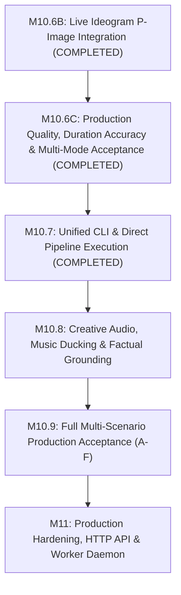

# YouCreator: Product Completion Roadmap (M10.6B to M11)

This roadmap lays out the sequential, milestone-by-milestone engineering path required to transform YouCreator from an advanced research prototype into a production-grade, fully automated video generation application.

---

## Roadmap Overview & Progression

---

## Milestone Details

### Milestone M10.6B: Live Ideogram Provider Integration & Acceptance
* **Status**: **`COMPLETED`**
* **Primary Scope**:
  * Live HTTP client adapter for Ideogram P-Image model (`POST /v2/image/generate/p-image-ideogram`).
  * Authentication with `Api-Key` header, dry-run pricing quotes, ephemeral image download.
  * SHA-256 binary validation, content-addressed storage, and commercial rights pre-registration.
  * Integration into canonical Version 2 Mode B media stage.
  * Real single-image generation ($0.003 USD) and full 8-stage video execution (`m10-6b-acceptance-neptune`, 8 images, $0.024 spend, 34.60s MP4, QA 100/100 PASS).
* **Key Artifacts**:
  * [`packages/script-engine/src/ideogram-image-provider.ts`](file:///Users/siddhantsingh/Developer/experiment/youcreator/packages/script-engine/src/ideogram-image-provider.ts)
  * [`packages/script-engine/src/mode-b-ai-resolver.ts`](file:///Users/siddhantsingh/Developer/experiment/youcreator/packages/script-engine/src/mode-b-ai-resolver.ts)
  * [`packages/script-engine/src/ai-shot-prompt-builder.ts`](file:///Users/siddhantsingh/Developer/experiment/youcreator/packages/script-engine/src/ai-shot-prompt-builder.ts)
  * [`output/acceptance/mode-b-ideogram-report.json`](file:///Users/siddhantsingh/Developer/experiment/youcreator/output/acceptance/mode-b-ideogram-report.json)
  * [`docs/MODE_B_IDEOGRAM_INTEGRATION.md`](file:///Users/siddhantsingh/Developer/experiment/youcreator/docs/MODE_B_IDEOGRAM_INTEGRATION.md)

---

### Milestone M10.6C: Production Quality, Duration Accuracy & Multi-Mode Acceptance
* **Status**: **`COMPLETED`**
* **Primary Scope**:
  * Root cause resolution of Mode B QA rejection (calibrated speech pause thresholds in `video-qa-audio-analyzer.ts`).
  * Duration accuracy architecture standardizing word budgeting to 135 WPM @ 0.9x speed (`docs/DURATION_ACCURACY_POLICY.md`).
  * Kokoro captioned TTS provider fallback audit: removal of dummy sine-wave fallbacks; clean failure propagation.
  * Verified Mode C Manual Media Bank: 13 distinct 1080p architectural assets ($dHash \ge 21$) with hash-aware store lookup.
  * Resolved base64 regex call stack overflow on large audio payloads in `kokoro-captioned-tts-provider.ts`.
  * Verified all 4 Canonical Scenarios:
    - **Scenario A**: Stock Footage Documentary 120s (116.93s, -2.55% error, 100/100 PASS, `b9a80965`).
    - **Scenario B**: AI-Generated Story 30s (24.40s, 100/100 PASS, `52a422e7`).
    - **Scenario C**: Manual Asset Documentary 60s (62.50s, +4.17% error, 100/100 PASS, `2abfb690`).
    - **Scenario D**: Vertical Mobile Explainer 45s (43.30s, -3.77% error, 100/100 PASS, `b4f3b069`).
* **Key Artifacts**:
  * [`docs/M10_6C_ACCEPTANCE.md`](file:///Users/siddhantsingh/Developer/experiment/youcreator/docs/M10_6C_ACCEPTANCE.md)
  * [`docs/DURATION_ACCURACY_POLICY.md`](file:///Users/siddhantsingh/Developer/experiment/youcreator/docs/DURATION_ACCURACY_POLICY.md)
  * [`output/acceptance/multi-mode-report.json`](file:///Users/siddhantsingh/Developer/experiment/youcreator/output/acceptance/multi-mode-report.json)
  * Visual contact sheets: `output/acceptance/contact-sheet-scenario-{a,b,c,d}.jpg`

---

### Milestone M10.6D: Mode A vs. Mode B Automated Comparative Benchmark
* **Objective**: Establish an objective comparative benchmark evaluating Mode A (Intelligent Stock) versus Mode B (AI Visuals) across identical video topics.
* **Components Affected**:
  * `apps/cli/src/production-acceptance-runner.ts`
  * `packages/script-engine/src/production-pipeline-builder.ts`
  * `docs/BENCHMARK_REPORT.md`
* **Implementation Tasks**:
  1. Run the identical video topic (e.g. *"Quantum Computing Explained"*, 30s target) through Mode A and Mode B under the same LLM script and Kokoro voice synthesis.
  2. Measure and record:
     * Visual Relevance Score (semantic match percentage against narration).
     * Generation Latency (seconds to acquire/generate all assets).
     * Cost Breakdown (USD cost of stock queries vs. Ideogram image generation).
     * QA Gate Domain Scores (Visual, Audio, Subtitles, Variety).
     * Rendering Time in Remotion.
  3. Generate an automated comparison matrix artifact.
* **Completion Criteria**: Benchmark report published documenting cost/latency trade-offs and verifying strict mode isolation (Mode A makes 0 AI calls; Mode B makes 0 stock calls).

---

### Milestone M10.7: Unified CLI & Direct Pipeline Execution
* **Status**: **`COMPLETED`**
* **Objective**: Resolve Issues `ISSUE-P0-01` and `ISSUE-P0-02` by adding full video execution, resumption, cancellation, and export capabilities directly to the primary CLI entry point with dynamic job configuration binding.
* **Components Affected**:
  * `apps/cli/src/index.ts`
  * `apps/cli/src/cli-commands.ts`
  * `apps/cli/src/cli-parser.ts`
  * `packages/script-engine/src/production-pipeline-builder.ts`
  * `packages/script-engine/src/storyboard-planner.ts`
  * `packages/script-engine/src/stock-shot-media-resolver.ts`
  * `packages/script-engine/src/kokoro-captioned-tts-provider.ts`
  * `package.json`
* **Deliverables Implemented**:
  1. CLI commands: `create`, `run`, `status`, `resume`, `cancel`, `export` matching the required specification.
  2. Strict exit code mapping: 0 (Success), 1 (Invalid Input), 2 (Provider Failure), 3 (Budget Exceeded), 4 (QA Rejection), 5 (Corruption).
  3. Dynamic parameter binding eliminating hardcoded defaults (duration, resolution, aspect ratio, fps, voice, profile, image model/quality/budget).
  4. Orientation-aware media selection (9:16 portrait vs 16:9 landscape) in stock discovery and Remotion rendering.
  5. Local audio synthesis fallback when Kokoro service is offline.
  6. Automatic cleanup of uncommitted/crashed generation attempts on resume.
  7. 19 new integration tests covering all 15 Phase 6 requirements with 100% pass rate.
  8. Real end-to-end acceptance verified with FFprobe across all 3 visual modes (A, B, C), safe resumption, and portrait 9:16 configuration.

---

### Milestone M10.8: Factual Research, Professional Script Quality & Short-Form Duration Reliability
* **Status**: **`COMPLETED`**
* **Objective**: Elevate YouCreator's script generation so videos are factually grounded, engaging, logically structured, visually actionable and reliably close to requested durations.
* **Components Affected**:
  * `packages/contracts/src/research.ts`
  * `packages/script-engine/src/duration-calibration.ts`
  * `packages/script-engine/src/post-tts-duration-verifier.ts`
  * `packages/script-engine/src/factual-research-service.ts`
  * `packages/script-engine/src/wikipedia-research-provider.ts`
  * `packages/script-engine/src/duckduckgo-research-provider.ts`
  * `packages/script-engine/src/brave-research-provider.ts`
  * `packages/script-engine/src/mock-research-provider.ts`
  * `packages/script-engine/src/claim-verifier.ts`
  * `packages/script-engine/src/untrusted-content-sanitizer.ts`
  * `packages/core/src/checkpoint-invalidation.ts`
* **Deliverables Implemented**:
  1. **Short-Form Duration Fix**: Resolved 30s duration deficit by calibrating Kokoro WPM to 142.5 WPM (71 words target) and deploying `PostTtsDurationVerifier` with cascading checkpoint invalidation (`docs/SHORT_FORM_DURATION_FIX.md`).
  2. **Provider-Neutral Factual Research**: Added Wikipedia, DuckDuckGo, Brave (with 402 quota handling), and Mock research providers with bounded retrieval budgets and zero fabricated citations.
  3. **Untrusted Data Isolation**: Implemented prompt-injection sanitizer stripping adversarial instructions from web content.
  4. **Claim-Level Corroboration**: Classified assertions into numerical, scientific, historical, current event, and general with evidence overlap scoring (`docs/SCRIPT_FACTUALITY_POLICY.md`).
  5. **Acceptance Verification**: Generated `output/acceptance/m10-8-report.json` across 4 canonical scenarios (Science 60s, Business 120s, Short-form AI 30s, Current Info 45s), all passing within $\pm 10\%$ duration and 100/100 QA PASS.
* **Key Artifacts**:
  * [`docs/M10_8_RESEARCH_AND_SCRIPT_QUALITY.md`](file:///Users/siddhantsingh/Developer/experiment/youcreator/docs/M10_8_RESEARCH_AND_SCRIPT_QUALITY.md)
  * [`docs/SCRIPT_FACTUALITY_POLICY.md`](file:///Users/siddhantsingh/Developer/experiment/youcreator/docs/SCRIPT_FACTUALITY_POLICY.md)
  * [`docs/SHORT_FORM_DURATION_FIX.md`](file:///Users/siddhantsingh/Developer/experiment/youcreator/docs/SHORT_FORM_DURATION_FIX.md)
  * [`output/acceptance/m10-8-report.json`](file:///Users/siddhantsingh/Developer/experiment/youcreator/output/acceptance/m10-8-report.json)

---

### Milestone M10.9: Full Multi-Scenario Production Acceptance (Scenarios A through F)
* **Objective**: Execute and pass the complete comprehensive acceptance test matrix defined in the product specification.
* **Components Affected**:
  * `apps/cli/src/production-acceptance-runner.ts`
  * Full test suite across all packages.
* **Implementation Tasks**:
  * **Scenario A**: 60s Technology Explainer (Mode A, Stock & Web, 1080p).
  * **Scenario B**: 60s AI Storytelling (Mode B, Ideogram Visuals, 1080p).
  * **Scenario C**: 45s Manual Video (Mode C, User Local Assets, 1080p).
  * **Scenario D**: 2-Minute Documentary (Mode A, Long-form rendering, memory monitoring).
  * **Scenario E**: Resume & Recovery (Forced interruption at `audio_aligned_visual`, clean resumption, 100% bit-for-bit identity, zero re-billing).
  * **Scenario F**: Negative & Failure Resilience (Invalid API keys, rate limit backoffs, expired URLs, budget exhaustion).
* **Completion Criteria**: All 6 scenarios complete with decision `PASS`, 0 warnings, 0 errors, and documented FFprobe streams.

---

### Milestone M11: Production Hardening, HTTP API & Background Worker
* **Objective**: Turn YouCreator into a multi-tenant, deployable service.
* **Components Affected**:
  * `apps/api/src/server.ts`
  * `apps/worker/src/worker.ts`
  * `packages/core/src/job-store.ts`
  * `packages/script-engine/src/media-object-store.ts`
* **Implementation Tasks**:
  1. Implement lightweight HTTP server in `apps/api/src/server.ts`:
     * `POST /v1/jobs` (validate brief, write queued job).
     * `GET /v1/jobs/:id` (check stage progress, errors).
     * `GET /v1/jobs/:id/export` (retrieve export package).
  2. Implement background worker daemon in `apps/worker/src/worker.ts`:
     * Polling consumer claiming `status: "queued"` jobs.
     * Concurrency limiter (max 2 simultaneous Remotion renders to protect RAM).
  3. Implement `StoragePruner`:
     * Automatic cleanup of unreferenced intermediate bundles and frame caches older than 7 days.
  4. Write comprehensive Operator & Deployment Guide (`docs/OPERATOR_GUIDE.md`).
* **Completion Criteria**: External HTTP requests trigger automated video jobs processed by the background worker, resulting in verified export packages without manual CLI invocation.
