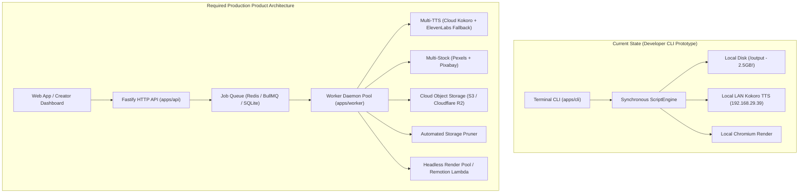

# 🔍 YouCreator Production Readiness Deep Audit

> **Audit Date:** October 2026  
> **Repository:** `youcreator`  
> **Status:** Core Video Engine Verified (100% Test Pass, 1078/1078 tests) | Missing SaaS & Production Operational Layers  

---

## 1. Executive Summary

YouCreator possesses an **exceptionally engineered, deterministic video synthesis core**:
- **8-Stage Pipeline:** Script $\to$ Storyboard $\to$ Media Resolution $\to$ Visual Assembly $\to$ Audio-Aligned Visuals $\to$ Remotion Rendering $\to$ Multi-Domain Video QA Gate $\to$ Production Video Export.
- **Strict Quality Control:** 100/100 QA score verification, word-level subtitle synchronization, sub-word Kokoro TTS alignment, and automated claim factuality checking.
- **Multi-Format Proven:** Mode A (Documentary Stock), Mode B (AI Visual Storytelling), Mode C (Manual Asset Banks), 16:9 Landscape (1080p), and 9:16 Vertical Mobile Shorts (1080×1920).

However, **YouCreator is currently a developer-operated CLI tool, not a deployable production product.** It cannot be launched as a customer-facing SaaS, automated backend, or high-availability service without addressing key architectural, infrastructure, and user experience gaps.

---

## 2. Critical Product & Architectural Gaps

### 🛑 GAP 1: Missing API Service (`apps/api` is Empty)
* **Current State:** `apps/api/` contains only `.gitkeep`.
* **Problem:** There are no HTTP REST endpoints, GraphQL, or WebSockets. No external application, mobile app, frontend dashboard, or automation tool (Zapier, Make, n8n, Webhooks) can interact with YouCreator.
* **Production Requirement:**
  - Build `apps/api/src/server.ts` (using Fastify or native `node:http`).
  - Endpoints needed:
    - `POST /v1/jobs` (validate brief, enqueue job, return Job ID).
    - `GET /v1/jobs/:id` (real-time stage progress, stage hashes, logs).
    - `GET /v1/jobs/:id/export` (retrieve video stream, subtitles, metadata).
    - `POST /v1/jobs/:id/cancel` (graceful cancellation).
    - `GET /healthz` & `/readyz` (liveness and readiness probes).

---

### 🛑 GAP 2: Missing Asynchronous Background Worker Daemon (`apps/worker` is Empty)
* **Current State:** `apps/worker/` contains only `.gitkeep`.
* **Problem:** Currently, jobs execute synchronously in the foreground inside the user's terminal. If the terminal closes, the user disconnects, or the network drops, the generation halts mid-stream.
* **Production Requirement:**
  - Build `apps/worker/src/worker.ts`.
  - Polling or message-driven consumer (BullMQ or SQLite job queue).
  - Concurrency management (limit simultaneous Remotion renders to 1–2 per host to prevent CPU/RAM starvation).
  - Exponential backoff retry logic on transient external API timeouts.

---

### 🛑 GAP 3: No User Interface (Web Dashboard / Creator Studio)
* **Current State:** Users must construct complex 300+ character shell commands in the terminal with multiple CLI flags (`--prompt`, `--mode`, `--duration`, `--ar`, `--profile`, etc.).
* **Problem:** Real content creators, marketers, and video editors do not use command-line interfaces.
* **Production Requirement:**
  - A responsive web application (Next.js or React + Vite):
    1. **Prompt Studio:** Text input with auto-prompt enhancer, genre selection (Documentary, Story, Explainer), and duration slider (15s to 120s).
    2. **Format Switcher:** One-click toggle between **Mobile Vertical Shorts (9:16)** and **YouTube Landscape (16:9)**.
    3. **Visual Style Selector:** Choose between Real Stock Media (Mode A) and AI Art Styles (2D Vector, Anime, Stick Man, Cyberpunk).
    4. **Live Stage Progress Tracker:** Visual stepper showing `[Script] ➔ [Storyboard] ➔ [Voice] ➔ [Visuals] ➔ [Render] ➔ [QA]`.
    5. **In-Browser Player & Export Suite:** Instant playback, subtitle preview, and 1-click download of MP4, SRT, VTT, and thumbnail.

---

### ⚠️ GAP 4: Unbounded Disk Growth (Storage Exhaustion Risk)
* **Current State:** `output/` has accumulated **2.5 Gigabytes** across 87 test jobs!
* **Problem:** Every video run creates raw uncompressed 48kHz WAV files, high-res images, Remotion Webpack bundles, FFmpeg temp frames, and MP4 exports. Without automated garbage collection, any cloud server will suffer disk exhaustion and crash.
* **Production Requirement:**
  - **Automated Storage Pruner:**
    - Purge intermediate Remotion Webpack bundles and extracted QA frames immediately after export.
    - Delete raw uncompressed WAVs once encoded into the final MP4.
    - Set configurable TTL on export packages (e.g., retain for 7 days or until uploaded to S3).
  - **CLI Maintenance Command:** `npm run cli -- prune --older-than 7d`.

---

### ⚠️ GAP 5: Local Single-Point-of-Failure on Speech Synthesis (Kokoro TTS)
* **Current State:** Kokoro TTS endpoint is hardcoded to a local private LAN IP (`http://192.168.29.39:8880`).
* **Problem:** If deployed to a cloud server (AWS, GCP, Railway, Render), `192.168.29.39` is completely unreachable. When the local host is turned off or on a different Wi-Fi network, the pipeline crashes with `PROVIDER_FAILURE (Exit Code 2)`.
* **Production Requirement:**
  - Cloud-deployable Kokoro instance (Dockerized on a GPU worker / Modal / RunPod).
  - Cloud TTS Provider Failover: Add automatic fallback to ElevenLabs or OpenAI TTS (`tts-1` with Whisper forced word alignment) when Kokoro is unreachable.

---

### ⚠️ GAP 6: Creative Value Gaps (Music Ducking & Subtitle Polish)
* **Current State:**
  - Background music is currently disabled (`music: null` hardcoded in `production-pipeline-builder.ts`).
  - Subtitles use a basic static Arial font with yellow text highlighting.
* **Problem:** Modern YouTube Shorts and TikToks require emotive background music and kinetic, high-energy subtitles to maintain viewer retention.
* **Production Requirement:**
  - **Royalty-Free Music Library:** Bundle 10–15 commercially cleared instrumental tracks in `data/music/` categorized by mood (Inspirational, Cinematic, Fast Tech, Mysterious).
  - **Dynamic Audio Ducking:** The engine code already supports ducking (`editorial-audio-plan.ts`); simply wire the asset bank into the pipeline builder.
  - **Kinetic Subtitle Styles:** Implement Remotion `spring()` transforms on the active word (subtle pop-in scale 1.0 $\to$ 1.15) and customizable fonts (Inter / Montserrat / Impact).

---

### ⚠️ GAP 7: Cloud Storage & Multi-Tenancy
* **Current State:** All media and exports are stored on the local filesystem (`output/media-storage`, `output/jobs`).
* **Problem:** Cannot scale across multiple servers or serverless containers. User A's jobs are not isolated from User B's jobs.
* **Production Requirement:**
  - **Cloud Object Storage Adapter:** Abstract storage behind S3-compatible interface (AWS S3, Cloudflare R2, MinIO).
  - **Tenant & Job Namespacing:** Store jobs by `tenantId/userId/jobId`.
  - **Signed Download URLs:** Generate short-lived presigned URLs for client video downloads.

---

### ⚠️ GAP 8: DevOps, Security & Production Observability
* **Current State:**
  - No Git tracking in workspace root.
  - No Dockerfile or docker-compose.
  - No user authentication or API rate limiting.
  - Logs are printed to stdout; no Sentry or OpenTelemetry crash reporting.
* **Production Requirement:**
  - Initialize Git repository and add `.gitignore` for `output/` and temporary artifacts.
  - Create production `Dockerfile` with Node 22, Chromium, and FFmpeg pre-installed.
  - Add API key authentication (`Authorization: Bearer <key>`) and per-user credit / duration quotas.
  - Integrate Sentry for runtime exception tracking and OpenTelemetry for pipeline stage duration tracing.

---

## 3. Prioritized Implementation Roadmap

| Priority | Feature / Component | Estimated Effort | Impact |
| :---: | :--- | :---: | :---: |
| **P0** | **Lightweight HTTP API (`apps/api`)** Endpoints for creating, monitoring, and retrieving video jobs. | 1.5 Days | **Enables All Integrations** |
| **P0** | **Background Worker Daemon (`apps/worker`)** Decoupled async job processing with concurrency limits. | 1.0 Day | **Server Stability & Reliability** |
| **P0** | **Storage Pruner & Cloud S3/R2 Adapter** Automatic intermediate cache purging and cloud object persistence. | 1.0 Day | **Prevents Disk Exhaustion** |
| **P1** | **Background Music Library & Auto-Ducking** Wire curated royalty-free tracks into `production-pipeline-builder.ts`. | 0.5 Day | **Massive Retention Boost** |
| **P1** | **Redundant TTS Provider (OpenAI / Cloud Failover)** Eliminate reliance on private LAN IP `192.168.29.39`. | 1.0 Day | **High Availability** |
| **P1** | **Web UI / Creator Studio** Clean modern Next.js/React dashboard for non-technical users. | 2.5 Days | **User-Ready Product** |
| **P2** | **Kinetic Subtitle Animations (Spring Pop-In)** Modern animated caption styles for Shorts / Reels. | 0.5 Day | **Aesthetic Polish** |
| **P2** | **Multi-Image Provider Failover (Flux / OpenAI)** Redundancy for Ideogram image generation outages. | 1.0 Day | **Disaster Recovery** |
| **P2** | **Docker Containerization & CI/CD** Dockerfile with pre-baked Chromium/FFmpeg and GitHub Actions test suite. | 1.0 Day | **1-Click Cloud Deployment** |
